# SRS TIGERNET v1.2: PHẦN BỔ SUNG (CHƯƠNG 9)

Tài liệu này là **chương 9 mới** của SRS "Hệ thống quản lý kho hàng TigerNet". Bản Word đầy đủ (chương 1 đến 8 cũ cộng chương 9 này) là `docs/SRS_He_Thong_Quan_Ly_Kho_v1_2.docx`. File Markdown này là bản gốc để sửa và so sánh thay đổi; bản Word được sinh lại từ nó.

- Phiên bản: 1.2 (bản nháp để duyệt)
- Ngày cập nhật: 10/11/2026
- Thay đổi so với 1.1: thêm 9 nhóm yêu cầu (mục 9.1 đến 9.9), dữ liệu cần thêm (9.10), use case mới UC-007 đến UC-014 (9.11), tiêu chí chấp nhận (9.12).
- Đánh giá có nên làm hay không, làm khi nào, tốn bao nhiêu công: xem báo cáo riêng `docs/Bao_cao_danh_gia_phuong_an_bo_sung.docx`.

## 9.0 Vì sao cần bổ sung chương này

> **Lý do, nói ngắn gọn:** bản 1.1 mới mô tả việc **quản lý hàng hóa** (nhập, xuất, thuê, kiểm kê). Khi đem đi dùng thật, doanh nghiệp cần thêm những việc xoay quanh **con người** dùng phần mềm: ai được xem gì, gặp lỗi thì báo ai, nhân viên nghỉ thì đơn của họ ai lo, khách đặt rồi không nhận thì xử lý ra sao, và chăm sóc khách từ lúc mới quen đến lúc mua lại. Chương này ghi những yêu cầu đó ra giấy để mọi người (kể cả người không làm kỹ thuật) cùng hiểu và cùng duyệt trước khi làm.

Chương này gồm 9 nhóm. Mỗi nhóm viết theo cùng một khuôn để dễ đọc:

1. **Vì sao cần** (đặt ngay đầu mục): vấn đề thực tế mà nhóm này giải quyết.
2. **Nói đơn giản**: giải thích bằng ví dụ đời thường.
3. **Quy trình từng bước**: ai làm gì, theo thứ tự nào.
4. **Yêu cầu cho phần mềm**: các dòng có mã (ví dụ FR-ACT-01) để lập trình viên và người kiểm thử bám theo.
5. **Hiện trạng dự án**: phần mềm hiện đã có gì liên quan, còn thiếu gì.

| Mục | Tên dễ hiểu | Tên gọi kỹ thuật | Mã yêu cầu |
| --- | --- | --- | --- |
| 9.1 | Xem phần mềm dưới góc nhìn của người khác | Act-as / impersonation | FR-ACT |
| 9.2 | Báo lỗi cho phòng IT ngay trong phần mềm | IT ticket, hot update | FR-TKT |
| 9.3 | Khóa phiếu lương bằng mã PIN | Payslip PIN | FR-PIN |
| 9.4 | Chốt đơn, chuyển cấp trên, giao lại việc | Order approval, auto-assign | FR-ORD |
| 9.5 | Hồ sơ nhân viên và chấm công online | HR / attendance | FR-HR |
| 9.6 | Đăng nhập bằng tài khoản Microsoft của tổ chức | SSO Microsoft Entra ID | FR-SSO |
| 9.7 | Xử lý khi khách "bom hàng" | Failed delivery / COD refusal | FR-BOM |
| 9.8 | Quản lý quan hệ khách hàng đầy đủ | CRM | FR-CRM |
| 9.9 | Thiết kế lấy người dùng làm trung tâm | UCD (User Centered Design) | PR-UCD |

**Từ ngữ dùng trong chương này**

| Từ | Nghĩa |
| --- | --- |
| Vai trò | Nhóm quyền của một người: Thủ kho, Kế toán, Bán hàng, Quản lý, Quản trị hệ thống. |
| Người trên quyền | Cấp trên trực tiếp của một nhân viên: trưởng nhóm hoặc quản lý. |
| Ticket | Một phiếu báo lỗi hoặc yêu cầu hỗ trợ, có số thứ tự, có người nhận và có trạng thái. |
| Bản vá nóng (hot update) | Bản sửa lỗi gấp được đưa lên hệ thống ngay, không chờ đợt cập nhật định kỳ. |
| Mã PIN | Dãy 6 chữ số riêng, khác mật khẩu đăng nhập, dùng để mở thông tin nhạy cảm. |
| Mã OTP | Mã dùng một lần, gửi qua email, hết hạn sau 10 phút. |
| Bom hàng | Khách đặt hàng (thường là trả tiền khi nhận) nhưng không nhận, không nghe máy hoặc từ chối khi giao tới. |
| CRM | Phần quản lý mọi việc với khách hàng: từ lúc mới biết đến khách, bán hàng, đến chăm sóc sau bán. |
| Khách tiềm năng (lead) | Người có thể sẽ mua nhưng chưa mua. |
| Cơ hội bán hàng | Một lần bán cụ thể đang được theo đuổi với một khách, có giá trị và ngày dự kiến chốt. |
| Nhật ký (audit log) | Bản ghi "ai, làm gì, lúc nào" mà phần mềm tự lưu, không ai sửa được. |

**Vai trò mới phát sinh.** Ngoài 5 vai trò ở mục 1.3, chương này cần thêm:

| Vai trò mới | Làm gì | Ghi chú |
| --- | --- | --- |
| Nhân viên IT (hỗ trợ) | Nhận và xử lý ticket báo lỗi | Có thể là người của doanh nghiệp hoặc người của bên cung cấp TIGERNET |
| Nhân sự (HR) | Lập hồ sơ nhân viên, quản lý chấm công, nhập bảng lương | Doanh nghiệp nhỏ có thể giao cho Kế toán kiêm |
| Chăm sóc khách hàng (CSKH) | Tiếp nhận khiếu nại, chạy chương trình chăm sóc | Doanh nghiệp nhỏ có thể giao cho Bán hàng kiêm |

---

## 9.1 Xem phần mềm dưới góc nhìn của người khác (Act-as)

> **Vì sao cần:** mỗi vai trò thấy một bộ menu, một phạm vi kho và một phần dữ liệu khác nhau. Khi nhân viên kêu "em không thấy nút Xác nhận" hay "em thấy sai số tồn", quản trị viên hiện phải hỏi mật khẩu của nhân viên hoặc đến tận máy để xem. Hỏi mật khẩu là vi phạm bảo mật, còn đến tận máy thì mất thời gian. Chức năng này cho phép quản trị viên **tự xem đúng màn hình nhân viên đó đang thấy**, mà không cần mật khẩu và không thể làm thay nhân viên.

**Nói đơn giản.** Giống chế độ "Xem với tư cách" của Facebook: bạn xem trang của mình như một người lạ đang xem, nhưng không thể đăng bài thay người đó.

**Quy trình**

1. Quản trị viên (hoặc Quản lý) mở menu "Xem với vai trò khác".
2. Chọn một trong hai cách: xem theo **vai trò** (ví dụ "Thủ kho kho Hà Nội") hoặc xem như **một nhân viên cụ thể**.
3. Nhập lý do (bắt buộc), ví dụ "Kiểm tra lỗi thiếu nút Xác nhận theo ticket #125".
4. Phần mềm chuyển sang giao diện của người đó. Trên cùng luôn có một dải màu cam ghi "Đang xem với tư cách: Nguyễn Văn A (Thủ kho)" và nút "Thoát".
5. Trong lúc xem, mọi nút lưu, xác nhận, xóa đều bị chặn. Bấm vào sẽ báo "Đang ở chế độ chỉ xem".
6. Bấm "Thoát" hoặc sau 30 phút, phần mềm tự trở về tài khoản quản trị.
7. Toàn bộ phiên xem được ghi vào nhật ký.

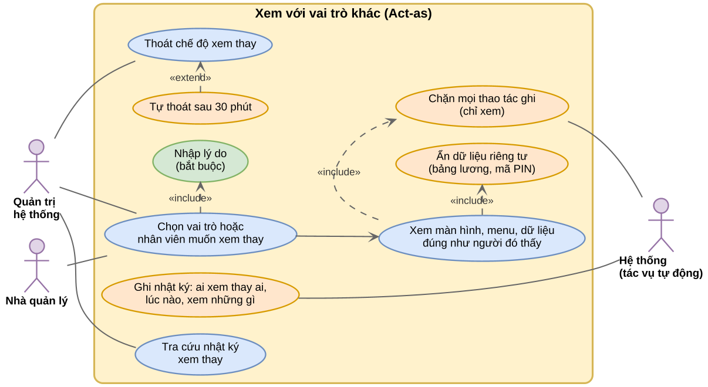

**Yêu cầu cho phần mềm**

| Mã | Yêu cầu |
| --- | --- |
| FR-ACT-01 | Quản trị hệ thống được xem thay mọi vai trò và mọi nhân viên trong cùng doanh nghiệp, trừ một Quản trị hệ thống khác. |
| FR-ACT-02 | Quản lý chỉ được xem thay nhân viên cấp dưới của mình (Thủ kho, Kế toán, Bán hàng). |
| FR-ACT-03 | Bắt buộc nhập lý do trước khi bắt đầu. Phiên xem tự kết thúc sau 30 phút (cấu hình được). |
| FR-ACT-04 | Chế độ chỉ xem phải được chặn **ở máy chủ**: mọi yêu cầu thêm, sửa, xóa trong phiên xem thay đều bị từ chối, không chỉ ẩn nút trên giao diện. |
| FR-ACT-05 | Menu, phân quyền trang, phạm vi kho và dữ liệu hiển thị phải giống hệt người được xem. |
| FR-ACT-06 | Không hiển thị phiếu lương, mã PIN, mật khẩu của người được xem (xem 9.3). |
| FR-ACT-07 | Nhật ký ghi: người xem, người bị xem, lý do, giờ bắt đầu, giờ kết thúc, các trang đã mở. Người bị xem được quyền xem ai đã xem thay mình. |
| FR-ACT-08 | Luôn hiện dải cảnh báo màu cam kèm nút Thoát trong suốt phiên xem thay. |

**Hiện trạng dự án.** Đã có phân quyền trang theo từng nhân viên (`User_Page_Permissions`), phân kho (`User_Warehouses`) và nhật ký (`Audit_Logs`). Còn thiếu: máy chủ chưa kiểm tra vai trò cho các API nghiệp vụ (sản phẩm, phiếu), mới chặn ở giao diện. Phải làm phần kiểm tra quyền ở máy chủ trước thì chế độ "chỉ xem" mới đáng tin.

---

## 9.2 Báo lỗi cho phòng IT ngay trong phần mềm (ticket)

> **Vì sao cần:** hiện nay khi gặp lỗi, nhân viên gọi điện hoặc nhắn Zalo cho IT, thường không nhớ lỗi xảy ra lúc mấy giờ, ở màn hình nào, đã bấm gì. IT phải hỏi lại nhiều lần, có lỗi bị quên vì tin nhắn trôi mất. Một nút "Báo lỗi" ngay trong phần mềm giúp **tự động ghi lại thời điểm, màn hình và ảnh chụp**, mỗi lỗi có số phiếu riêng, theo dõi được đến khi sửa xong.

**Nói đơn giản.** Giống gọi tổng đài bảo hành: mỗi lần báo được cấp một mã phiếu, bạn tra được phiếu đang ở bước nào, và khi sửa xong bạn được hỏi "đã ổn chưa".

**Quy trình**

1. Người dùng gặp lỗi, bấm nút "Báo lỗi" (biểu tượng con bọ ở góc màn hình).
2. Phần mềm tự chụp ảnh màn hình hiện tại và tự điền: thời điểm gặp lỗi, tên màn hình, kho đang làm việc, vai trò, phiên bản phần mềm, trình duyệt, lỗi gần nhất máy chủ trả về.
3. Người dùng viết vài dòng mô tả, chọn mức độ (Khẩn cấp, Cao, Thường, Thấp), có thể gắn thêm ảnh hoặc xóa ảnh nếu ảnh lộ thông tin nhạy cảm, rồi bấm Gửi.
4. IT nhận ticket, phân loại và giao người sửa.
5. Trong lúc sửa, ticket có thể chuyển sang:
   - **Gián đoạn (interrupted)**: đang sửa thì phải dừng vì lý do ngoài ý muốn, ví dụ có lỗi gấp hơn, chờ người báo cung cấp thêm thông tin, máy chủ sự cố. Bắt buộc ghi lý do; sau 24 giờ phần mềm nhắc làm tiếp.
   - **Tạm hoãn (deferred)**: chủ động dời sang đợt cập nhật sau vì lỗi nhỏ hoặc cần sửa lớn. Bắt buộc ghi hạn xử lý mới; lỗi mức Cao trở lên cần trưởng nhóm duyệt mới được hoãn.
6. Sửa xong và kiểm thử xong, ticket chờ phát hành. Lỗi nặng được phát hành ngay bằng **bản vá nóng (hot update)**; người dùng thấy thông báo "Có bản cập nhật mới, bấm để tải lại".
7. Người báo lỗi kiểm tra lại và bấm **"Đã hết lỗi" (check-done)**. Nếu vẫn lỗi thì bấm "Vẫn còn lỗi" để mở lại. Sau 3 ngày không phản hồi, ticket tự đóng.

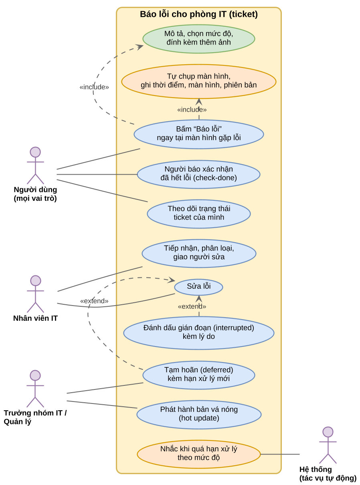

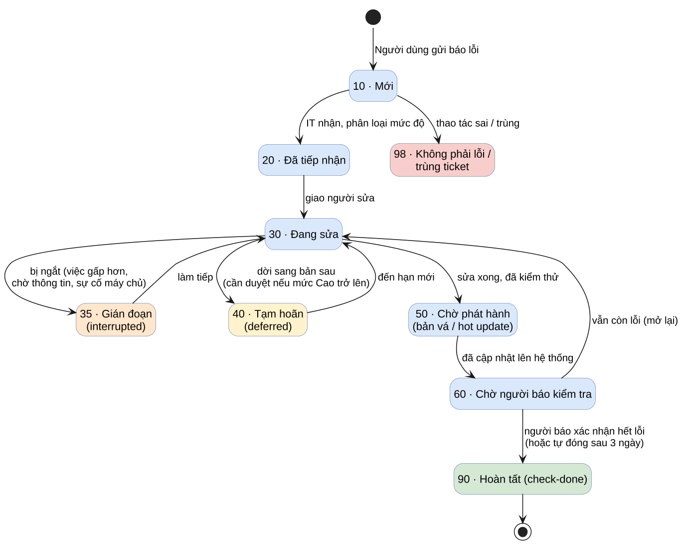

**Bảng trạng thái ticket** (đánh số theo cùng kiểu với các luồng trạng thái nghiệp vụ khác của dự án)

| Mã | Trạng thái | Ý nghĩa | Ai đang lo |
| --- | --- | --- | --- |
| 10 | Mới | Vừa gửi, chưa ai nhận | IT |
| 20 | Đã tiếp nhận | IT đã đọc, đã chọn mức độ | Trưởng nhóm IT |
| 30 | Đang sửa | Đã giao người sửa | Người sửa |
| 35 | Gián đoạn | Đang sửa thì bị ngắt, có ghi lý do | Người sửa |
| 40 | Tạm hoãn | Dời sang bản sau, có hạn mới | Trưởng nhóm IT |
| 50 | Chờ phát hành | Đã sửa, đã kiểm thử, chờ đưa lên | Người phát hành |
| 60 | Chờ người báo kiểm tra | Đã cập nhật lên hệ thống | Người báo lỗi |
| 90 | Hoàn tất (check-done) | Người báo xác nhận hết lỗi | Không ai |
| 98 | Không phải lỗi / trùng | Thao tác sai hoặc đã có ticket khác | Không ai |

**Thời hạn xử lý theo mức độ**

| Mức độ | Ví dụ | Phản hồi đầu tiên | Hướng xử lý |
| --- | --- | --- | --- |
| Khẩn cấp | Không đăng nhập được, không xuất kho được | 30 phút | Bản vá nóng trong ngày |
| Cao | Sai số tồn, sai tiền trên phiếu | 4 giờ làm việc | Bản vá nóng hoặc bản kế tiếp |
| Thường | Một nút bị lỗi nhưng có cách làm khác | 1 ngày làm việc | Đợt cập nhật định kỳ |
| Thấp | Sai chính tả, lệch giao diện | 3 ngày làm việc | Khi thuận tiện |

**Quy trình bản vá nóng (hot update), giữ đúng quy tắc nhánh của dự án**

1. Tạo nhánh sửa lỗi từ phiên bản đang chạy thật.
2. Mở yêu cầu gộp code (PR) vào nhánh `dev`, chạy kiểm thử tự động.
3. Đưa lên máy chủ thử nghiệm (staging), người báo lỗi hoặc IT thử lại.
4. **Chủ dự án duyệt** việc đưa lên nhánh `main` và máy chủ thật. Không ai tự đẩy lên `main`.
5. Đưa lên máy chủ thật. Ứng dụng web tự phát hiện phiên bản mới và nhắc người dùng tải lại trang.
6. Ticket chuyển sang trạng thái 60, ghi số phiên bản đã sửa.

**Yêu cầu cho phần mềm**

| Mã | Yêu cầu |
| --- | --- |
| FR-TKT-01 | Nút "Báo lỗi" có trên mọi màn hình sau khi đăng nhập, kể cả màn hình báo lỗi kết nối. |
| FR-TKT-02 | Tự ghi: thời điểm gặp lỗi (cho sửa lại nếu người dùng báo muộn), thời điểm gửi, người gửi, vai trò, kho, đường dẫn màn hình, phiên bản, trình duyệt, mã lỗi gần nhất. |
| FR-TKT-03 | Tự chụp ảnh màn hình; cho xem trước, xóa, hoặc gắn thêm tối đa 5 ảnh (mỗi ảnh không quá 5 MB). |
| FR-TKT-04 | Ticket đi theo đúng bảng trạng thái ở trên; mọi lần đổi trạng thái lưu người đổi, giờ đổi, ghi chú. |
| FR-TKT-05 | Chuyển sang Gián đoạn hoặc Tạm hoãn bắt buộc ghi lý do; Tạm hoãn bắt buộc ghi hạn mới; Tạm hoãn ticket mức Cao trở lên cần trưởng nhóm duyệt. |
| FR-TKT-06 | Nhắc tự động khi quá thời hạn phản hồi theo mức độ, khi Gián đoạn quá 24 giờ, khi Tạm hoãn đến hạn. |
| FR-TKT-07 | Người báo được thông báo mỗi khi ticket đổi trạng thái và được bấm "Đã hết lỗi" hoặc "Vẫn còn lỗi". |
| FR-TKT-08 | Ứng dụng kiểm tra phiên bản máy chủ định kỳ; có bản mới thì hiện thông báo tải lại. |
| FR-TKT-09 | Báo cáo: số ticket theo mức độ, thời gian xử lý trung bình, số ticket bị mở lại, số ticket đang hoãn. |

**Hiện trạng dự án.** Chưa có gì về ticket. Bảng `Alerts` đang dùng cho cảnh báo nghiệp vụ, không dùng chung cho ticket. Chưa có quy trình phát hành tự động (CI/CD) nên phần "bản vá nóng" phụ thuộc vào việc dựng quy trình phát hành trước.

---

## 9.3 Khóa phiếu lương bằng mã PIN (Payslip PIN)

> **Vì sao cần:** lương là thông tin rất riêng tư. Máy tính ở kho, ở quầy thường dùng chung, nhân viên hay quên đăng xuất. Nếu chỉ cần đã đăng nhập là xem được lương thì người ngồi cạnh cũng xem được. Thêm một lớp mã PIN riêng giúp **chỉ đúng chủ nhân mới mở được phiếu lương**, kể cả khi máy đang đăng nhập sẵn.

**Nói đơn giản.** Giống ứng dụng ngân hàng: đã mở app rồi nhưng muốn xem số dư hoặc chuyển tiền vẫn phải nhập thêm mã PIN.

**Quy trình**

1. Hằng tháng, Kế toán (hoặc Nhân sự) nhập bảng lương từ file Excel vào phần mềm, kiểm tra rồi bấm "Công bố".
2. Nhân viên mở mục "Phiếu lương của tôi". Lần đầu, phần mềm yêu cầu tạo mã PIN 6 số.
3. Những lần sau, nhân viên nhập PIN để mở. Phiếu lương hiện ra có in mờ tên người xem.
4. Không thao tác 5 phút, phiếu lương tự đóng, muốn xem lại phải nhập PIN.
5. Nhập sai 5 lần liên tiếp thì khóa xem lương 15 phút.
6. Quên PIN: nhân viên bấm "Quên PIN", nhận mã OTP qua email, đặt PIN mới.

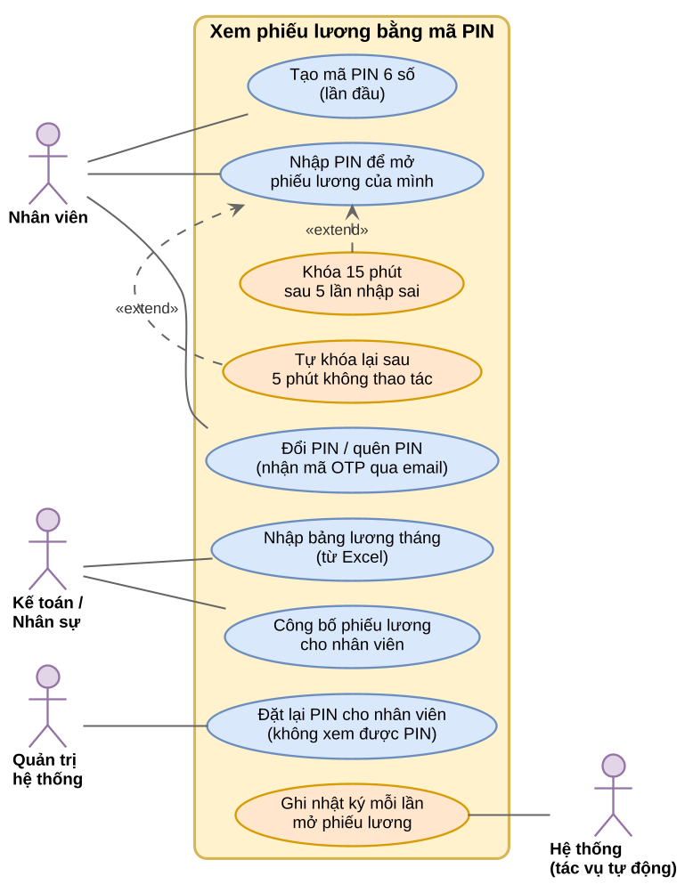

**Yêu cầu cho phần mềm**

| Mã | Yêu cầu |
| --- | --- |
| FR-PIN-01 | PIN gồm đúng 6 chữ số, khác mật khẩu đăng nhập, không chấp nhận dãy dễ đoán (123456, 000000, 6 số trùng nhau, ngày sinh). |
| FR-PIN-02 | PIN được mã hóa một chiều (bcrypt) như mật khẩu; không ai, kể cả quản trị viên, xem được PIN. |
| FR-PIN-03 | Sai 5 lần liên tiếp khóa 15 phút (giống quy tắc khóa đăng nhập hiện có). |
| FR-PIN-04 | Mở thành công thì được xem trong 5 phút không thao tác; quá thời gian phải nhập lại. |
| FR-PIN-05 | Quên PIN: đặt lại qua OTP gửi email (OTP hết hạn 10 phút). Quản trị viên chỉ được "buộc đặt lại", không đặt hộ. |
| FR-PIN-06 | Nhân viên chỉ thấy phiếu lương của chính mình. Kế toán, Nhân sự xem được của mọi người nhưng cũng phải nhập PIN của chính họ. |
| FR-PIN-07 | Chế độ xem thay (9.1) không mở được phiếu lương. |
| FR-PIN-08 | Mỗi lần mở phiếu lương, nhập sai PIN, đặt lại PIN đều ghi nhật ký. |
| FR-PIN-09 | Số tiền lương lưu trong cơ sở dữ liệu ở dạng mã hóa (đáp ứng mục 4.2 "mã hóa dữ liệu nhạy cảm"). |
| FR-PIN-10 | Phần mềm **không tự tính lương** (thuế thu nhập cá nhân, bảo hiểm xã hội). Bảng lương được nhập từ Excel hoặc phần mềm kế toán; ngày công lấy từ chấm công ở 9.5. |

**Hiện trạng dự án.** Chưa có phân hệ nhân sự, chưa có dữ liệu lương. Đã có sẵn mã hóa bcrypt, cơ chế khóa sau nhiều lần sai và kế hoạch gửi OTP qua email (dùng lại được cho PIN). Hợp đồng mẫu (Phụ lục 01) chưa có phân hệ nhân sự, nên đây là **phần mở rộng phạm vi**.

---

## 9.4 Chốt đơn, chuyển cấp trên và giao lại việc

> **Vì sao cần:** hiện đơn hàng gắn chặt với người tạo. Khi nhân viên bán hàng nghỉ ốm, nghỉ phép hay nghỉ việc, đơn của họ bị treo, khách gọi không ai nghe, hàng giữ cho khách hết hạn mà không ai biết. Cấp trên cũng không có chỗ xem gọn "nhóm mình đang có những đơn nào, ai đang ôm". Quy trình này đảm bảo **mọi đơn đã chốt đều đi qua người trên quyền**, và **không đơn nào bị bỏ rơi** vì người phụ trách vắng mặt.

**Nói đơn giản.** Giống lớp học có giáo viên chủ nhiệm: bài tập nộp lên giáo viên; bạn nào nghỉ thì giáo viên giao phần việc của bạn đó cho bạn khác, và sổ ghi rõ ai đã nhận thay.

**Quy trình**

1. Nhân viên bán hàng thống nhất với khách: hàng gì, số lượng, giá, ngày giao, cách trả tiền. Bấm **"Chốt đơn"**.
2. Đơn tự chuyển lên **người trên quyền** (trưởng nhóm hoặc quản lý được khai báo trong hồ sơ nhân viên).
3. Người trên quyền xem được toàn bộ: khách hàng, hàng hóa, giá, giảm giá, công nợ hiện tại của khách, lịch sử trao đổi. Rồi chọn:
   - **Duyệt**: đơn chuyển sang kho để xuất.
   - **Trả lại**: ghi lý do, đơn quay về nhân viên sửa.
   - **Giao cho người khác**: chọn nhân viên khác xử lý tiếp.
4. **Giao lại tự động.** Phần mềm tự chuyển đơn sang nhân viên khác trong cùng nhóm hoặc cùng kho khi:
   - người phụ trách có ngày nghỉ việc (ngày ra làm) đã đến;
   - người phụ trách đang nghỉ phép đã duyệt, hoặc đến giữa ca chưa chấm công vào (lấy từ 9.5);
   - đơn không có thao tác nào quá số giờ quy định (mặc định 24 giờ).
5. Người nhận được chọn theo luật cấu hình: **ít việc nhất** (mặc định) hoặc **xoay vòng**. Người nhận, người trên quyền và người cũ (nếu còn làm) đều được báo.
6. Mỗi lần chuyển giao đều lưu: từ ai, sang ai, ai quyết định (người hay hệ thống), lý do, thời điểm.

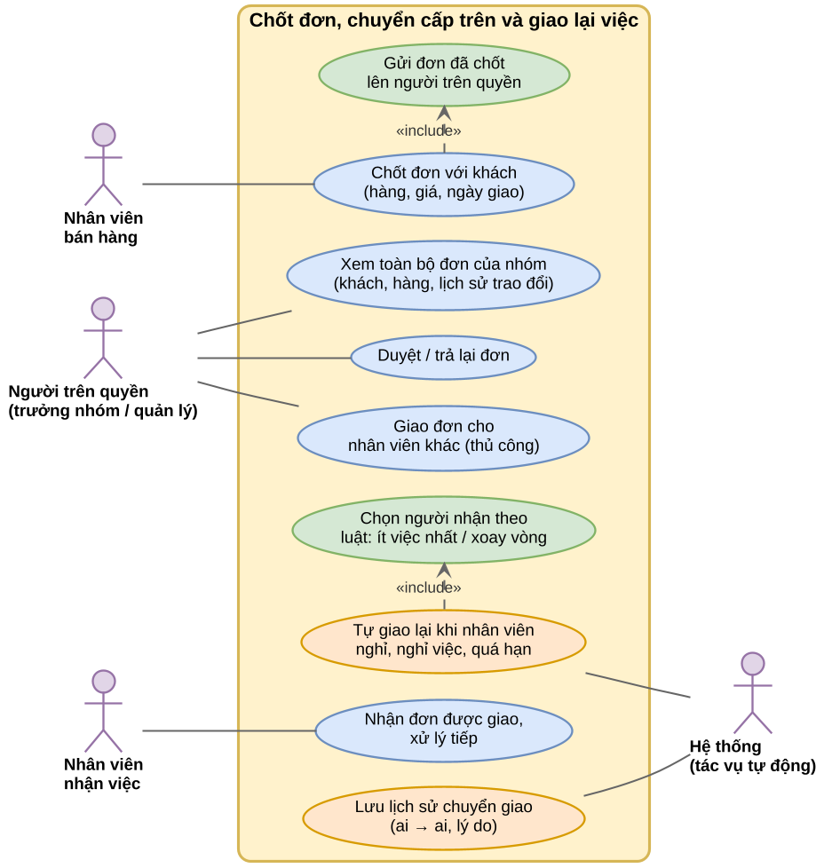

**Bảng trạng thái đơn bán**

| Mã | Trạng thái | Ý nghĩa | Ai đang lo |
| --- | --- | --- | --- |
| 10 | Nháp | Đang trao đổi với khách | Nhân viên bán hàng |
| 20 | Đã chốt, chờ duyệt | Đã gửi lên người trên quyền | Người trên quyền |
| 30 | Đã duyệt, chờ xuất kho | Thủ kho chuẩn bị hàng | Thủ kho |
| 40 | Đã xuất kho | Hàng rời kho | Bộ phận giao hàng |
| 50 | Đang giao | Đã giao cho đơn vị vận chuyển | Đơn vị giao hàng |
| 90 | Hoàn tất | Khách đã nhận, đã thu tiền hoặc ghi nợ | Kế toán |
| 97 | Giao thất bại / khách bom | Xem mục 9.7 | Nhân viên bán hàng, Thủ kho |
| 98 | Bị trả lại | Người trên quyền không duyệt | Nhân viên bán hàng |
| 99 | Đã hủy | Hủy theo yêu cầu của khách hoặc nội bộ | Không ai |

**Yêu cầu cho phần mềm**

| Mã | Yêu cầu |
| --- | --- |
| FR-ORD-01 | Mỗi nhân viên có một "người trên quyền". Người trên quyền thấy toàn bộ đơn của cấp dưới (trực tiếp và gián tiếp). |
| FR-ORD-02 | Đơn có hai thông tin tách riêng: **người tạo** (không đổi) và **người đang phụ trách** (đổi được khi giao lại). |
| FR-ORD-03 | Bấm "Chốt đơn" thì đơn khóa sửa và chuyển lên người trên quyền; có thể cấu hình miễn duyệt cho đơn dưới một giá trị nhất định. |
| FR-ORD-04 | Người trên quyền được Duyệt, Trả lại (bắt buộc lý do), Giao cho người khác (chọn người trong nhóm hoặc kho). |
| FR-ORD-05 | Tác vụ tự động chạy mỗi 15 phút, giao lại theo 3 điều kiện ở bước 4. Không giao cho người đang nghỉ hoặc chưa chấm công. |
| FR-ORD-06 | Luật chọn người nhận cấu hình được: ít việc nhất hoặc xoay vòng; chỉ chọn trong cùng kho hoặc cùng nhóm. |
| FR-ORD-07 | Mọi lần giao lại được lưu lịch sử đầy đủ và thông báo cho các bên. |
| FR-ORD-08 | Khi nhân viên nghỉ việc, ngoài đơn, các **khách hàng** họ phụ trách (CRM, 9.8) và **lệnh giữ hàng** (3.4.2) cũng được giao lại. |

**Hiện trạng dự án.** Phiếu xuất (`Export_Receipts`) có 3 trạng thái PENDING, CONFIRMED, EXPORTED và chỉ có `Created_By` (người tạo). Chưa có người phụ trách, người trên quyền, lịch sử giao việc, chưa có tác vụ chạy định kỳ. Chưa có API xác nhận đơn (đã ghi trong báo cáo luồng trạng thái ngày 05/11/2026).

---

## 9.5 Hồ sơ nhân viên và chấm công online

> **Vì sao cần:** để giao lại việc tự động (9.4) và tính ngày công cho phiếu lương (9.3), phần mềm phải biết **ai đang đi làm, ai đã nghỉ việc, hôm nay ai vắng**. Hiện chấm công thường bằng giấy hoặc máy vân tay riêng, không nối với phần mềm. Chấm công ngay trên app, cùng với ngày vào làm và ngày nghỉ việc, giúp số liệu nhân sự và số liệu bán hàng khớp nhau.

**Nói đơn giản.** Giống điểm danh đầu giờ và cuối giờ, nhưng bấm trên điện thoại, và chỉ bấm được khi đang ở công ty.

**Quy trình**

1. Khi tuyển, Nhân sự lập hồ sơ: họ tên, tài khoản đăng nhập, **ngày vào làm**, ngày ký hợp đồng chính thức, người trên quyền, kho làm việc, ca làm.
2. Mỗi ngày, nhân viên mở app bấm **"Vào ca"** khi đến và **"Ra ca"** khi về. App kiểm tra nhân viên đang ở trong mạng Wi-Fi của công ty, hoặc trong bán kính cho phép quanh kho (ví dụ 200 m).
3. Quên bấm "Ra ca": app nhắc lúc hết ca cộng 30 phút. Qua ngày vẫn chưa bấm thì ghi "thiếu giờ ra", nhân viên làm giải trình.
4. Đi muộn, về sớm, quên chấm, xin nghỉ: nhân viên gửi đơn trên app, người trên quyền duyệt.
5. Cuối tháng, Nhân sự xem bảng công, xuất Excel, chuyển sang tính lương.
6. Khi nhân viên nghỉ việc, Nhân sự nhập **ngày nghỉ việc (ngày ra làm)**. Hết ngày đó, phần mềm tự khóa tài khoản và giao lại toàn bộ việc dở dang (9.4).

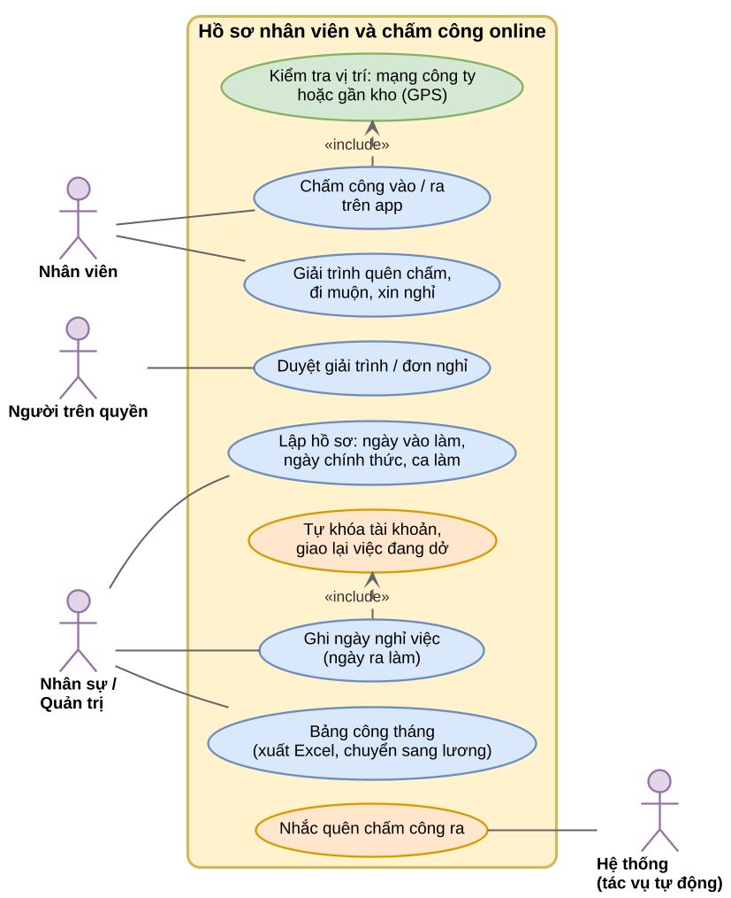

**Yêu cầu cho phần mềm**

| Mã | Yêu cầu |
| --- | --- |
| FR-HR-01 | Hồ sơ nhân viên gắn 1-1 với tài khoản: ngày vào làm, ngày chính thức, ngày nghỉ việc, người trên quyền, kho chính, ca làm. |
| FR-HR-02 | Danh mục ca làm: giờ vào, giờ ra, số phút cho phép đi muộn. |
| FR-HR-03 | Chấm công vào và ra; mỗi lần chấm lưu giờ máy chủ (không lấy giờ điện thoại), cách xác minh (Wi-Fi/IP công ty hoặc GPS), tọa độ nếu có. |
| FR-HR-04 | Danh sách địa điểm hợp lệ theo từng kho: dải IP mạng công ty, tọa độ và bán kính. Ngoài phạm vi thì không cho chấm, hoặc cho chấm nhưng đánh dấu "cần duyệt" (cấu hình được). |
| FR-HR-05 | Đơn từ: giải trình quên chấm, đi muộn, về sớm, nghỉ phép; người trên quyền duyệt hoặc từ chối. |
| FR-HR-06 | Bảng công tháng theo nhân viên: số ngày công, đi muộn, nghỉ có phép, nghỉ không phép; xuất Excel. |
| FR-HR-07 | Đến ngày nghỉ việc: khóa tài khoản lúc 23:59, giao lại việc theo FR-ORD-08, giữ nguyên lịch sử chứng từ của người đó. |
| FR-HR-08 | Xin đồng ý của nhân viên trước khi lấy vị trí GPS và chỉ lấy vị trí đúng lúc bấm chấm công (Nghị định 13/2023/NĐ-CP về bảo vệ dữ liệu cá nhân). |

**Hiện trạng dự án.** Bảng `Users` chỉ có ngày tạo tài khoản và cờ đang hoạt động. Chưa có ngày vào làm, ngày nghỉ việc, người trên quyền, ca làm, chấm công. Ứng dụng hiện chạy trên web (Flutter Web); lấy GPS trên trình duyệt được nhưng kém chính xác hơn app điện thoại, nên khuyến nghị dùng Wi-Fi/IP công ty làm cách chính.

---

## 9.6 Đăng nhập bằng tài khoản Microsoft của tổ chức

> **Vì sao cần:** nhiều doanh nghiệp, trường học đã dùng Microsoft 365, mỗi nhân viên có một email dạng **aaa@theenest.edu.vn**. Người quản trị Microsoft của tổ chức (Admin Microsoft) **có toàn quyền với mọi tài khoản thuộc tên miền đó**: tạo, khóa, xóa, đặt lại mật khẩu, bắt buộc xác thực hai lớp. Nếu TIGERNET cho đăng nhập bằng chính tài khoản này thì: nhân viên không phải nhớ thêm mật khẩu; khi một người nghỉ việc, Admin Microsoft chỉ cần khóa một chỗ là người đó mất quyền vào mọi hệ thống, kể cả TIGERNET; và dữ liệu luôn thuộc về tổ chức, không thuộc về cá nhân.

**Nói đơn giản.** Giống thẻ ra vào tòa nhà do ban quản lý tòa nhà cấp: ban quản lý thu thẻ là bạn không vào được bất kỳ văn phòng nào. Còn trong văn phòng bạn được ngồi phòng nào, mở tủ nào là do công ty bạn quyết.

**Phân chia quyền giữa hai bên**

| Việc | Admin Microsoft của tổ chức | Quản trị viên TIGERNET |
| --- | --- | --- |
| Tạo, khóa, xóa tài khoản email | Có | Không |
| Đặt lại mật khẩu, bật xác thực hai lớp | Có | Không |
| Cho phép TIGERNET dùng tài khoản tổ chức (đồng ý một lần) | Có | Không |
| Gán vai trò (Thủ kho, Kế toán...) trong TIGERNET | Không | Có |
| Gán kho, phân quyền trang trong TIGERNET | Không | Có |
| Khóa riêng quyền vào TIGERNET của một người | Không cần | Có |

Admin Microsoft **không tự động** là quản trị viên TIGERNET; hai quyền tách riêng, muốn kiêm thì phải gán thêm trong TIGERNET.

**Quy trình**

1. Bên cung cấp TIGERNET khai báo tên miền của khách (ví dụ `theenest.edu.vn`) gắn với đúng doanh nghiệp đó trên hệ thống.
2. Admin Microsoft của tổ chức đăng nhập lần đầu và bấm "Đồng ý" cho TIGERNET đọc thông tin cơ bản (họ tên, email) của tài khoản tổ chức. Chỉ làm một lần.
3. Nhân viên bấm **"Đăng nhập bằng Microsoft"**, nhập email và mật khẩu tại trang của Microsoft (TIGERNET không bao giờ thấy mật khẩu này).
4. Lần đầu đăng nhập, TIGERNET tạo người dùng ở trạng thái **"Chờ cấp quyền"**, chưa thấy dữ liệu gì. Quản trị viên TIGERNET gán vai trò và kho.
5. Khi Admin Microsoft khóa hoặc xóa tài khoản, người đó không đăng nhập được nữa; phiên đang mở bị ngắt chậm nhất sau 1 giờ (thời hạn phiên đăng nhập). Muốn ngắt ngay thì quản trị viên TIGERNET bấm khóa thêm.

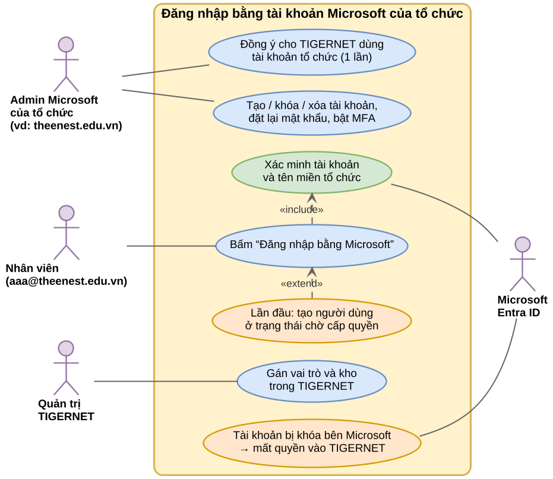

**Yêu cầu cho phần mềm**

| Mã | Yêu cầu |
| --- | --- |
| FR-SSO-01 | Hỗ trợ đăng nhập bằng Microsoft Entra ID (Microsoft 365) theo chuẩn OpenID Connect; vẫn giữ đăng nhập bằng tên và mật khẩu. |
| FR-SSO-02 | Chỉ chấp nhận tài khoản thuộc tên miền và tổ chức Microsoft đã khai báo cho doanh nghiệp đó; tài khoản tên miền lạ bị từ chối. |
| FR-SSO-03 | Nhận diện người dùng bằng mã định danh cố định của Microsoft, không chỉ bằng email (email có thể bị đổi). |
| FR-SSO-04 | Lần đăng nhập đầu tạo người dùng "Chờ cấp quyền"; có thể nối với tài khoản TIGERNET đã có cùng email sau khi quản trị viên xác nhận. |
| FR-SSO-05 | Mỗi lần làm mới phiên (tối đa 1 giờ), kiểm tra lại với Microsoft; tài khoản đã bị khóa thì đăng xuất. |
| FR-SSO-06 | Quản trị viên TIGERNET có thể bắt buộc "chỉ đăng nhập bằng Microsoft" cho cả doanh nghiệp. |
| FR-SSO-07 | (Giai đoạn sau) Đồng bộ tự động danh sách nhân viên và nhóm từ Microsoft (chuẩn SCIM), nhóm Microsoft ánh xạ sang vai trò TIGERNET. |

**Hiện trạng dự án.** Mục 3.1.1 của SRS 1.1 đã ghi "hỗ trợ xác thực qua Gmail hoặc mail công ty" nhưng chưa làm. Đăng nhập hiện chỉ bằng tên và mật khẩu, phát token riêng của TIGERNET. Kiến trúc nhiều khách hàng (mỗi khách một cơ sở dữ liệu, có máy chủ quản lý trung tâm) đã có bảng `tenants`, nên khai báo tên miền theo khách là khả thi.

---

## 9.7 Xử lý khi khách "bom hàng"

> **Vì sao cần:** với hàng giao tận nơi và trả tiền khi nhận, khách đặt rồi không nhận gây ra bốn thiệt hại cùng lúc: mất phí vận chuyển hai chiều, hàng bị giữ không bán được cho người khác, hàng có thể hư hỏng khi hoàn về, và doanh thu, công nợ trên sổ bị sai. Hiện phần mềm coi đơn đã xuất kho là xong, không có chỗ ghi "giao không thành công". Quy trình này giúp **thu hồi hàng về kho đúng số lượng, ghi đúng chi phí, và nhận diện khách hay bom để phòng trước**.

**Nói đơn giản.** Giống nhà hàng ghi sổ khách đặt bàn rồi không đến: lần đầu nhắc nhở, lần hai bắt đặt cọc, lần ba không nhận đặt bàn nữa.

**Quy trình** (xem Hình 9.7)

1. **Phòng trước khi giao.** Khi tạo đơn, phần mềm tự kiểm tra lịch sử khách: số lần đã bom, số điện thoại có trong danh sách đen không. Khách có rủi ro thì yêu cầu đặt cọc hoặc chuyển khoản trước. Đơn giá trị lớn thì gọi xác nhận trước khi xuất kho.
2. **Khi giao không thành.** Đơn vị giao hàng báo không giao được (khách không nghe máy, từ chối, sai địa chỉ). Giao tối đa 3 lần.
3. **Liên hệ lại.** Nhân viên phụ trách gọi khách trong 24 giờ. Khách hẹn lại thì đặt ngày giao mới. Không liên lạc được hoặc khách từ chối thì đánh dấu **"Khách bom hàng"** và chọn lý do.
4. **Nhận hàng hoàn.** Thủ kho nhận hàng về, kiểm tra từng món (theo serial nếu có):
   - còn tốt: nhập lại kho, trở thành hàng bán được;
   - hư, thiếu: ghi hàng hư, lập biên bản yêu cầu đơn vị giao hàng bồi thường.
5. **Ghi sổ.** Kế toán ghi chi phí vận chuyển hai chiều, trừ vào tiền cọc nếu có; hủy doanh thu và công nợ của đơn; nếu đã xuất hóa đơn điện tử thì lập hóa đơn điều chỉnh hoặc thay thế theo quy định.
6. **Đánh dấu khách.** Phần mềm cộng 1 lần bom vào hồ sơ khách: lần 1 ghi cảnh báo, lần 2 bắt buộc cọc cho đơn sau, từ lần 3 đưa vào danh sách đen và báo quản lý (số lần cấu hình được).
7. **Báo cáo.** Tỉ lệ bom theo nhân viên, khu vực, kênh bán, đơn vị giao hàng; tổng chi phí do bom hàng mỗi tháng.

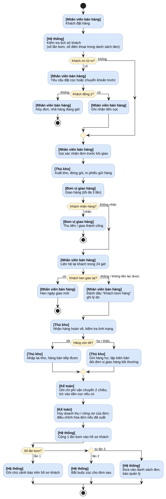

**Yêu cầu cho phần mềm**

| Mã | Yêu cầu |
| --- | --- |
| FR-BOM-01 | Đơn sau khi xuất kho có thêm trạng thái giao hàng: Đang giao, Giao thành công, Giao thất bại, Đang hoàn về, Đã nhận hàng hoàn. |
| FR-BOM-02 | Ghi từng lần giao: lần thứ mấy, ngày giờ, kết quả, lý do thất bại, mã vận đơn. |
| FR-BOM-03 | Đánh dấu "Khách bom hàng" bắt buộc chọn lý do: không nghe máy, từ chối nhận, đổi ý, sai địa chỉ, khác. |
| FR-BOM-04 | Nhận hàng hoàn tạo phiếu nhập hàng hoàn về đúng kho xuất (hoặc kho gần nhất), cộng lại tồn, trả serial về "Trong kho" hoặc "Hư hỏng". |
| FR-BOM-05 | Lệnh giữ hàng của đơn được nhả ngay khi đơn bị hủy hoặc bom. |
| FR-BOM-06 | Ghi phiếu chi phí vận chuyển; trừ cọc theo quy định; hủy công nợ phải thu của đơn. |
| FR-BOM-07 | Hồ sơ khách có: số lần bom, mức rủi ro, cờ danh sách đen; danh sách đen tra theo cả số điện thoại, kể cả khách mới. |
| FR-BOM-08 | Khi tạo đơn cho khách có rủi ro, phần mềm cảnh báo và yêu cầu nhập tiền cọc; khách trong danh sách đen chỉ Quản lý mới cho tạo đơn. |
| FR-BOM-09 | Báo cáo tỉ lệ bom và chi phí bom hàng theo tháng, theo nhân viên, khu vực, đơn vị giao hàng. |

**Hiện trạng dự án.** Đã có: phiếu xuất có trường cọc (`Deposit`), phiếu gửi hàng mẫu A5, phiếu thu chi (`Payments`), trả hàng bán (`Sales_Returns`), trạng thái serial (`IN_STOCK`, `RESERVED`, `DAMAGED`). Còn thiếu: trạng thái giao hàng sau khi xuất, lịch sử lần giao, đếm số lần bom trên khách, danh sách đen. Hàng hoàn có thể tận dụng luồng trả hàng bán hiện có với loại "hàng hoàn do giao thất bại" (không tính phí đổi trả).

---

## 9.8 Quản lý quan hệ khách hàng đầy đủ (CRM)

> **Vì sao cần:** phần mềm hiện chỉ biết khách hàng **sau khi đã mua** (có phiếu xuất, phiếu thuê). Trước đó, việc tìm khách, gọi điện, báo giá đều nằm trong sổ tay hoặc Zalo của từng nhân viên; nhân viên nghỉ là mất khách. Sau khi bán, không ai nhắc gia hạn thuê, không ai hỏi thăm khách cũ. CRM gom **toàn bộ vòng đời của khách vào một chỗ**, để công ty (chứ không phải từng nhân viên) nắm khách, và để quản lý biết đơn sắp tới từ đâu.

**Nói đơn giản.** Giống cuốn sổ khách quen của chủ tiệm lâu năm: biết khách là ai, đã mua gì, hay hỏi gì, lần trước nói chuyện lúc nào, sắp tới nên gọi lại khi nào. Chỉ khác là sổ này dùng chung cho cả công ty và không bị mất khi người giữ sổ nghỉ việc.

**Vòng đời khách hàng: 10 bước**

| Bước | Tên | Việc chính | Ai làm | TIGERNET hiện có? |
| --- | --- | --- | --- | --- |
| 1 | Thu hút | Quảng cáo, giới thiệu, khách tự tìm đến | Bán hàng, Marketing | Chưa |
| 2 | Khách tiềm năng | Ghi tên, số điện thoại, nhu cầu, nguồn khách | Bán hàng | Chưa |
| 3 | Sàng lọc, liên hệ | Gọi trong 24 giờ, xác định có nhu cầu thật | Bán hàng | Chưa |
| 4 | Cơ hội bán hàng | Ghi giá trị dự kiến, ngày dự kiến chốt, giai đoạn | Bán hàng | Chưa |
| 5 | Báo giá, thương lượng | Lập báo giá, gửi khách, sửa giá | Bán hàng, Quản lý duyệt giảm giá | Chưa (mới có trên giao diện, chưa có API) |
| 6 | Chốt đơn | Duyệt, xuất kho hoặc cho thuê (mục 9.4) | Bán hàng, Quản lý, Thủ kho | Có một phần (phiếu xuất, phiếu thuê) |
| 7 | Giao hàng, thu tiền | Giao, thu tiền, theo dõi công nợ | Thủ kho, Kế toán | Có (phiếu thu chi, đối chiếu công nợ) |
| 8 | Chăm sóc sau bán | Bảo hành, đổi trả, khiếu nại | CSKH, Thủ kho | Có bảo hành, đổi trả; chưa có khiếu nại |
| 9 | Giữ chân, bán thêm | Nhắc gia hạn thuê, ưu đãi khách cũ, sinh nhật | CSKH, Bán hàng | Có cảnh báo hạn thuê; chưa có chương trình chăm sóc |
| 10 | Đo lường | Tỉ lệ chuyển đổi, khách quay lại, doanh số theo nhân viên | Quản lý | Có báo cáo doanh thu; chưa có báo cáo phễu |

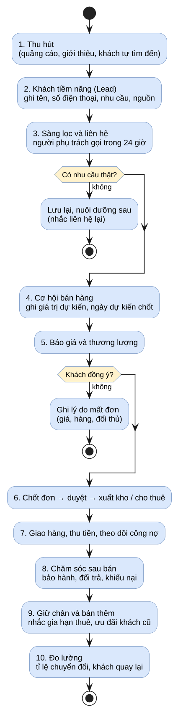

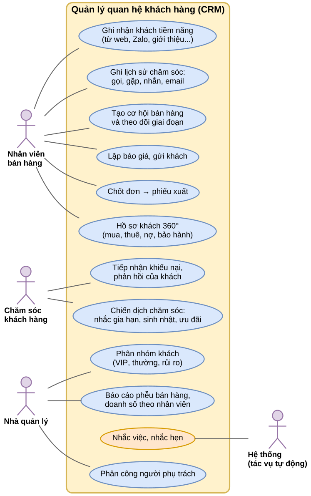

**Giai đoạn của khách tiềm năng và cơ hội bán hàng**

| Mã | Giai đoạn | Ý nghĩa | Ai đang lo |
| --- | --- | --- | --- |
| 10 | Mới | Vừa ghi nhận, chưa liên hệ | Người phụ trách |
| 20 | Đã liên hệ | Đã gọi hoặc nhắn được | Người phụ trách |
| 30 | Có nhu cầu | Khách xác nhận cần hàng, đã rõ ngân sách | Người phụ trách |
| 40 | Đã báo giá | Đã gửi báo giá | Người phụ trách |
| 50 | Thương lượng | Đang trao đổi giá, điều kiện | Người phụ trách, Quản lý |
| 60 | Chờ chốt | Khách đồng ý miệng, chờ xác nhận | Người phụ trách |
| 90 | Thắng | Đã chốt đơn, chuyển thành phiếu xuất hoặc phiếu thuê | Thủ kho, Kế toán |
| 98 | Thua | Khách không mua; bắt buộc ghi lý do (giá, hàng, đối thủ, không phản hồi) | Không ai |
| 99 | Tạm dừng nuôi dưỡng | Chưa có nhu cầu, hẹn liên hệ lại | Người phụ trách |

**Yêu cầu cho phần mềm**

| Mã | Yêu cầu |
| --- | --- |
| FR-CRM-01 | **Khách tiềm năng**: ghi tên, điện thoại, email, công ty, nhu cầu, nguồn (web, Zalo, Facebook, giới thiệu, đến trực tiếp), người phụ trách. Cảnh báo trùng theo số điện thoại hoặc mã số thuế. |
| FR-CRM-02 | **Người phụ trách khách**: mỗi khách có một người phụ trách; đổi người phụ trách được lưu lịch sử; nhân viên nghỉ việc thì giao lại tự động (FR-ORD-08). |
| FR-CRM-03 | **Người liên hệ**: một khách doanh nghiệp có nhiều người liên hệ (giám đốc, kế toán, người nhận hàng). |
| FR-CRM-04 | **Lịch sử chăm sóc**: ghi mỗi lần gọi, gặp, nhắn, email; ngày giờ, nội dung, kết quả, hẹn lần sau. |
| FR-CRM-05 | **Việc cần làm và nhắc hẹn**: tạo việc kèm hạn; phần mềm nhắc khi đến hạn và khi quá hạn. |
| FR-CRM-06 | **Cơ hội bán hàng**: giá trị dự kiến, ngày dự kiến chốt, giai đoạn theo bảng trên; xem dạng bảng kéo thả theo giai đoạn. |
| FR-CRM-07 | **Báo giá**: lập từ cơ hội, chọn hàng từ danh mục, áp chính sách giá; giảm giá vượt mức cho phép cần Quản lý duyệt; in hoặc gửi PDF; báo giá được chấp nhận chuyển thành đơn (9.4). |
| FR-CRM-08 | **Hồ sơ khách 360 độ**: một màn hình xem toàn bộ: thông tin, người liên hệ, lịch sử chăm sóc, báo giá, đơn mua, phiếu thuê, công nợ, bảo hành, đổi trả, khiếu nại, số lần bom hàng. |
| FR-CRM-09 | **Phân nhóm khách**: VIP, thường, mới, rủi ro; theo luật tự động (doanh số 12 tháng, số lần mua, nợ quá hạn, bom hàng) hoặc gán tay. |
| FR-CRM-10 | **Khiếu nại và phản hồi của khách** (khác ticket IT ở 9.2): tiếp nhận, giao người xử lý, hạn trả lời, kết quả, mức hài lòng. |
| FR-CRM-11 | **Chương trình chăm sóc**: nhắc gia hạn thuê trước 7 ngày, chúc sinh nhật, ưu đãi khách lâu không mua; gửi qua email trước, Zalo OA ở giai đoạn sau. |
| FR-CRM-12 | **Báo cáo**: phễu bán hàng (số lượng và giá trị theo giai đoạn), tỉ lệ chuyển đổi, lý do thua, doanh số và số cuộc gọi theo nhân viên, tỉ lệ khách quay lại. |
| FR-CRM-13 | **Quyền xem**: nhân viên bán hàng chỉ thấy khách mình phụ trách và khách chưa có người phụ trách; người trên quyền thấy khách của cả nhóm; Quản lý thấy tất cả. |

**Hiện trạng dự án.** Đã có nền tốt cho nửa sau của vòng đời: danh bạ chung `Parties` (cá nhân và tổ chức), `Customers`, `Receivers`, phiếu xuất, phiếu thuê, công nợ, đối chiếu công nợ, bảo hành, đổi trả, cảnh báo hạn thuê. Còn thiếu toàn bộ nửa đầu: khách tiềm năng, cơ hội, báo giá, lịch sử chăm sóc, người phụ trách, phân nhóm, khiếu nại, chương trình chăm sóc. Kế hoạch ERP/CRM ngày 06/11/2026 đã xếp CRM lõi vào giai đoạn 2 (quý 2/2027).

---

## 9.9 Thiết kế lấy người dùng làm trung tâm (UCD)

> **Vì sao cần:** người dùng TIGERNET chủ yếu là thủ kho, nhân viên bán hàng, kế toán, không rành máy tính, làm việc trong kho ồn, tay cầm hàng, hay bị ngắt quãng. Một màn hình thiết kế theo cảm nhận của lập trình viên có thể đúng về chức năng nhưng khiến thủ kho bấm nhầm kho, nhập sai số lượng, dẫn đến **sai tồn kho thật**. UCD là cách làm bắt buộc **hỏi và quan sát người dùng thật trước, cho họ thử trước khi lập trình xong**, để sửa sai khi còn rẻ, thay vì sửa sau khi đã phát hành.

**Nói đơn giản.** Giống thợ may đo: đo người trước, may thử, cho mặc thử, sửa, rồi mới may hoàn chỉnh. Không may sẵn một cỡ rồi bắt mọi người mặc vừa.

**UCD là gì.** Là cách làm phần mềm theo tiêu chuẩn quốc tế ISO 9241-210, dựa trên 4 nguyên tắc:

1. Hiểu rõ **ai dùng, dùng để làm gì, dùng ở đâu**.
2. Người dùng **tham gia suốt quá trình**, không chỉ lúc nghiệm thu.
3. Thiết kế được **đánh giá bằng người dùng thật**, có số đo.
4. **Làm lặp**: thiết kế, thử, sửa, thử lại cho đến khi đạt.

**Quy trình áp dụng cho TIGERNET**

| Bước | Việc làm | Cách làm cụ thể ở TIGERNET | Kết quả |
| --- | --- | --- | --- |
| 0. Lập kế hoạch | Xác định người dùng, mục tiêu đo | 5 vai trò, mỗi vai trò chọn 3 việc hay làm nhất (ví dụ thủ kho: nhập kho, xuất kho, kiểm kê) | Kế hoạch UCD 1 trang |
| 1. Tìm hiểu người dùng và bối cảnh | Phỏng vấn, quan sát tại chỗ | Phỏng vấn 1 đến 2 người mỗi vai trò; đứng quan sát ở kho nửa ngày | Chân dung người dùng (persona), hành trình công việc |
| 2. Viết yêu cầu từ phía người dùng | Biến quan sát thành yêu cầu | Ví dụ: "Thủ kho cần quét serial bằng một tay", "Kế toán cần xuất Excel đúng mẫu đang dùng" | Bổ sung vào SRS và danh sách việc (backlog) |
| 3. Thiết kế phương án | Phác thảo, làm bản bấm thử | Phác thảo trên giấy, rồi Figma, rồi bản bấm thử được (bản demo offline đã có sẵn) | Bản thiết kế, bản bấm thử |
| 4. Đánh giá với người dùng thật | Cho làm thử, đo | 5 người mỗi vai trò; đo tỉ lệ làm xong, thời gian, số lần bấm sai; điểm hài lòng SUS từ 68 trở lên | Danh sách lỗi dễ dùng, quyết định sửa |
| Lặp lại | Quay lại bước 1 đến 3 | Đến khi đạt mục tiêu đo | Thiết kế đạt |
| 5. Lập trình, phát hành | Làm theo thiết kế đã duyệt | Đối chiếu bảng kiểm tra giao diện `UXUI_Checklist.xlsx` | Phiên bản mới |
| 6. Theo dõi sau phát hành | Lắng nghe phản hồi | Ticket báo lỗi (9.2), góp ý trong app; dùng chế độ xem thay (9.1) để thấy đúng màn hình người dùng | Đưa vào vòng UCD kế tiếp |

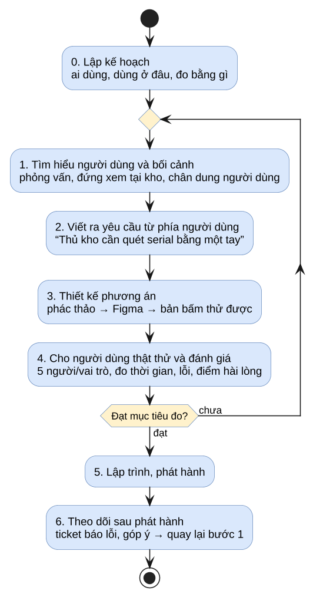

**Yêu cầu về quy trình**

| Mã | Yêu cầu |
| --- | --- |
| PR-UCD-01 | Mỗi chức năng mới có ảnh hưởng đến giao diện phải có bản bấm thử và được ít nhất 3 người dùng thật của vai trò đó thử trước khi lập trình hoàn chỉnh. |
| PR-UCD-02 | Mỗi đợt phát hành lớn đo lại điểm SUS cho 5 vai trò; mục tiêu từ 68 trở lên, chức năng cốt lõi (nhập, xuất, kiểm kê) từ 75 trở lên. |
| PR-UCD-03 | Việc chính của mỗi vai trò làm xong trong không quá 3 màn hình và không quá 2 phút với người đã được hướng dẫn. |
| PR-UCD-04 | Phản hồi người dùng từ ticket và góp ý được tổng hợp mỗi tháng, đưa vào danh sách việc của đợt sau. |

**Hiện trạng dự án.** Đã có: thiết kế Figma, bản demo offline bấm thử được, bảng kiểm tra giao diện `UXUI_Checklist.xlsx`, sơ đồ use case cho 13 phân hệ. Còn thiếu: chân dung người dùng, buổi thử với người dùng thật và số đo (thời gian, tỉ lệ lỗi, điểm SUS).

---

## 9.10 Dữ liệu cần bổ sung

Bảng dưới liệt kê dữ liệu mới, viết theo cùng quy ước tên bảng của `Database_Design_v7.md`. Chi tiết cột sẽ được chốt khi viết file chuyển đổi cơ sở dữ liệu (Flyway) cho từng đợt.

| Nhóm | Bảng hoặc cột mới | Nội dung chính | Nơi lưu |
| --- | --- | --- | --- |
| 9.1 Act-as | `Act_As_Sessions` | Người xem, người bị xem hoặc vai trò, lý do, giờ bắt đầu, giờ kết thúc | Cơ sở dữ liệu của từng khách |
| 9.2 Ticket | `support_tickets`, `support_ticket_events`, `support_ticket_attachments`, `releases` | Ticket, lịch sử trạng thái, ảnh chụp, phiên bản phát hành | Máy chủ quản lý trung tâm (Control Plane) để bên cung cấp xử lý được cho mọi khách |
| 9.3 Phiếu lương | `Users.Pin_Hash`, `Pin_Failed_Count`, `Pin_Locked_Until`; `Payslips`, `Payslip_Items` | PIN mã hóa, khóa tạm; phiếu lương theo tháng, các khoản (mã hóa số tiền) | Cơ sở dữ liệu của từng khách |
| 9.4 Đơn và giao việc | `Users.Manager_ID`; `Export_Receipts.Assigned_To`, `Approved_By`, `Approved_At`; `Assignment_History`; `Assignment_Rules` | Người trên quyền, người phụ trách đơn, duyệt, lịch sử giao lại, luật chọn người | Cơ sở dữ liệu của từng khách |
| 9.5 Nhân sự | `Employees` (Hire_Date, Official_Date, Leave_Date, Shift_ID), `Work_Shifts`, `Attendance_Records`, `Attendance_Requests`, `Attendance_Locations` | Hồ sơ, ca, chấm công, đơn từ, địa điểm hợp lệ | Cơ sở dữ liệu của từng khách |
| 9.6 Microsoft | `User_Identities` (Provider, Subject, Issuer_Tenant); `tenant_sso_domains` | Liên kết tài khoản Microsoft với người dùng; tên miền của khách | Từng khách; Control Plane |
| 9.7 Bom hàng | `Export_Receipts.Delivery_Status`; `Delivery_Attempts`; `Customers.Failed_Delivery_Count`, `Risk_Level`, `Is_Blacklisted`; `Phone_Blacklist` | Trạng thái giao, từng lần giao, đếm bom, danh sách đen | Cơ sở dữ liệu của từng khách |
| 9.8 CRM | `Leads`, `Opportunities`, `Quotes`, `Quote_Details`, `Activities`, `Tasks`, `Contacts`, `Customer_Segments`, `Complaints`, `Campaigns`, `Campaign_Members`; `Customers.Owner_User_ID`, `Source`, `Segment_ID` | Toàn bộ dữ liệu CRM ở mục 9.8 | Cơ sở dữ liệu của từng khách |
| Chung | `Alerts.Alert_Type` thêm loại `TICKET_OVERDUE`, `TASK_DUE`, `ATTENDANCE_MISSING`, `DELIVERY_FAILED` | Cảnh báo mới | Cơ sở dữ liệu của từng khách |

---

## 9.11 Use case bổ sung

| ID | Tên | Tác nhân chính | Điều kiện trước | Luồng chính (tóm tắt) | Kết quả |
| --- | --- | --- | --- | --- | --- |
| UC-007 | Xem với vai trò khác | Quản trị hệ thống, Quản lý | Đã đăng nhập, có quyền xem thay | Chọn vai trò hoặc người, nhập lý do, xem, thoát | Phiên xem được ghi nhật ký, không có dữ liệu nào bị thay đổi |
| UC-008 | Báo lỗi cho IT | Mọi người dùng | Đã đăng nhập | Bấm Báo lỗi, hệ thống chụp màn hình, nhập mô tả, gửi | Ticket ở trạng thái 10, người dùng nhận mã ticket |
| UC-009 | Xử lý ticket đến khi hoàn tất | Nhân viên IT | Có ticket trạng thái 10 | Tiếp nhận, sửa (có thể gián đoạn, tạm hoãn), phát hành, người báo xác nhận | Ticket trạng thái 90 |
| UC-010 | Xem phiếu lương bằng PIN | Nhân viên | Phiếu lương tháng đã công bố | Mở mục lương, nhập PIN, xem, tự đóng sau 5 phút | Nhật ký mở phiếu lương được ghi |
| UC-011 | Chốt đơn và giao lại | Bán hàng, Người trên quyền | Đơn ở trạng thái Nháp | Chốt, người trên quyền duyệt, trả lại hoặc giao người khác; hệ thống tự giao lại khi vắng | Đơn có người phụ trách hợp lệ, lịch sử giao được lưu |
| UC-012 | Chấm công online | Nhân viên | Có hồ sơ và ca làm | Vào ca, hệ thống kiểm tra vị trí, ra ca; giải trình nếu thiếu | Bản ghi công trong ngày |
| UC-013 | Đăng nhập bằng Microsoft | Nhân viên tổ chức | Tên miền đã khai báo, Admin Microsoft đã đồng ý | Bấm đăng nhập bằng Microsoft, xác thực ở Microsoft, quay về TIGERNET | Vào hệ thống đúng quyền; lần đầu ở trạng thái chờ cấp quyền |
| UC-014 | Xử lý khách bom hàng | Bán hàng, Thủ kho, Kế toán | Đơn đã xuất kho, đang giao | Báo giao thất bại, liên hệ lại, đánh dấu bom, nhận hàng hoàn, ghi chi phí, cập nhật hồ sơ khách | Tồn kho, công nợ, chi phí đúng; khách được gắn mức rủi ro |
| UC-015 | Quản lý khách tiềm năng đến chốt đơn | Bán hàng | Có thông tin khách tiềm năng | Ghi lead, liên hệ, tạo cơ hội, báo giá, chốt (UC-011) | Cơ hội ở trạng thái 90 hoặc 98 kèm lý do |
| UC-016 | Tiếp nhận khiếu nại của khách | CSKH | Khách đã có trong hệ thống | Ghi khiếu nại, giao người xử lý, trả lời, đóng, đo hài lòng | Khiếu nại đóng, lưu vào hồ sơ 360 độ |

---

## 9.12 Tiêu chí chấp nhận bổ sung

| Mã | Tiêu chí | Cách kiểm |
| --- | --- | --- |
| AC-ACT-01 | Trong phiên xem thay, mọi lệnh thêm, sửa, xóa gửi thẳng vào API đều bị từ chối (mã 403) | Gọi API bằng Postman với token xem thay |
| AC-ACT-02 | Menu và dữ liệu khi xem thay khớp 100% với khi chính nhân viên đó đăng nhập | So sánh ảnh chụp 5 vai trò |
| AC-TKT-01 | Ticket gửi từ bất kỳ màn hình nào đều có ảnh chụp, thời điểm, đường dẫn màn hình, phiên bản | Gửi thử từ 10 màn hình |
| AC-TKT-02 | Không đóng được ticket khi người báo chưa xác nhận, trừ khi đã quá 3 ngày | Kiểm thử trạng thái |
| AC-PIN-01 | Sai 5 lần khóa 15 phút; quản trị viên và chế độ xem thay không mở được phiếu lương của người khác | Kiểm thử bảo mật |
| AC-ORD-01 | Nhân viên có ngày nghỉ việc là hôm nay: 0 đơn, 0 khách, 0 lệnh giữ hàng còn đứng tên người đó sau 00:15 hôm sau | Dữ liệu thử và tác vụ tự động |
| AC-HR-01 | Chấm công ngoài mạng công ty và ngoài bán kính bị từ chối hoặc đánh dấu cần duyệt theo cấu hình | Thử từ mạng 4G và mạng công ty |
| AC-SSO-01 | Tài khoản tên miền khác bị từ chối; tài khoản bị Admin Microsoft khóa mất quyền vào chậm nhất 1 giờ | Thử với tài khoản thử của tổ chức |
| AC-BOM-01 | Sau khi nhận hàng hoàn: tồn kho cộng lại đúng, công nợ của đơn về 0, phiếu chi vận chuyển được ghi, số lần bom của khách tăng 1 | Kịch bản thử từ đầu đến cuối |
| AC-CRM-01 | Hồ sơ khách 360 độ hiển thị đủ 11 loại thông tin ở FR-CRM-08 trong không quá 2 giây | Dữ liệu thử 10.000 khách |
| AC-UCD-01 | Có biên bản thử với người dùng thật và điểm SUS cho mỗi đợt phát hành lớn | Hồ sơ dự án |
